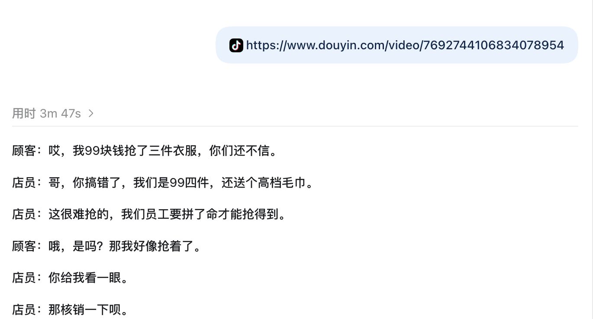

# 抖音链接转品牌脚本

**输入一条抖音参考视频链接，整理成带角色的原稿，再结合品牌套餐规则，生成可拍摄的品牌台词。**

**[打开完整演示](https://jaden20030518-lgtm.github.io/douyin-link-to-script/)** · [查看工具源码](docs/source.md) · [查看测试报告](reports/2026-09-26-script-accuracy/README.md)

## 看一次真实运行



原片99元套餐包含**3件衣服＋1条毛巾，共4件**。按用户指定的169元两件套餐，保留人物问答，改稿中的对应台词为：

```text
店员：哥，你搞错了，我们是169元两件。
店员：秋季上新的T恤、休闲裤、卫衣，吊牌价99元的款任选两件。
```

<sub>截图由本人提供，原样保留。界面“3m47s”是这一轮原稿整理的显示用时，不包含后续169两件改编。[查看同条视频的完整会话摘录](docs/session-excerpt.md)</sub>

## 我负责的部分

- 用 Codex 独立搭建画面文字识别、语音转写、原稿整理与品牌改编的工作流。
- 整理产品、优惠券和品牌规则，明确哪些台词保留、哪些字段可以替换。
- 试跑并核对输出，根据实际识别和改写问题调整规则。

## 实际使用

短视频团队已使用，累计处理 **50条参考视频**，产出下发门店职人。

本人使用时，单条机器处理约 **10分钟**；这不是展示案例的独立计时，也不是每条节省的人工时间。

<sub>团队使用与时长依据本人项目记录；50条为处理的参考视频数，不代表发布数或转化结果。</sub>
